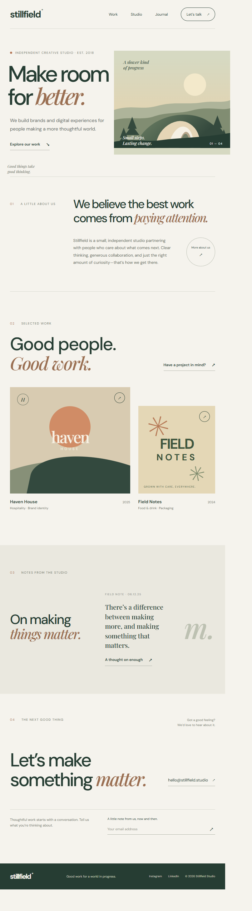

# Stillfield Studio

Stillfield Studio is a polished, responsive landing page concept for an independent creative studio. Its warm editorial style pairs clear typography and generous spacing with original landscape and project illustrations. The page introduces the studio, showcases selected work, shares a journal note, and invites visitors to get in touch.

The site is built with plain HTML, CSS, and JavaScript. It has no build step, framework, or package dependencies.



## Project files

| File | Purpose |
| --- | --- |
| `index.html` | Page content, metadata, navigation, and form markup |
| `styles.css` | Visual design, responsive layouts, illustrations, and reduced-motion styles |
| `script.js` | Mobile navigation, current footer year, and newsletter form interaction |
| `screenshot.png` | Full-page preview of the landing page |

## Run locally

No installation is needed. Open `index.html` directly in a browser, or run a local server from the project folder:

```sh
python -m http.server 8000
```

Then open [http://localhost:8000](http://localhost:8000).

## Features

- Responsive navigation that switches to a toggleable menu on small screens
- Original hero landscape illustration in inline SVG; project artwork drawn with CSS
- Smooth in-page navigation and subtle hover interactions
- Accessible navigation labels, form feedback announcements, and reduced-motion support
- Newsletter email validation and an on-page confirmation
- Current year displayed automatically in the footer

## Customization

- Edit the copy, section content, links, and metadata in `index.html`.
- Adjust colors, typography, spacing, and mobile breakpoints in `styles.css`. The main palette and font stacks are defined as CSS custom properties near the top of the file.
- Update menu, footer-year, or newsletter interactions in `script.js`.
- The Google Fonts stylesheet is loaded from Google Fonts; system font fallbacks are included.

The newsletter form currently validates the email in the browser and displays a confirmation message. It does not submit or store addresses; connect it to a newsletter provider or backend to collect subscriptions.